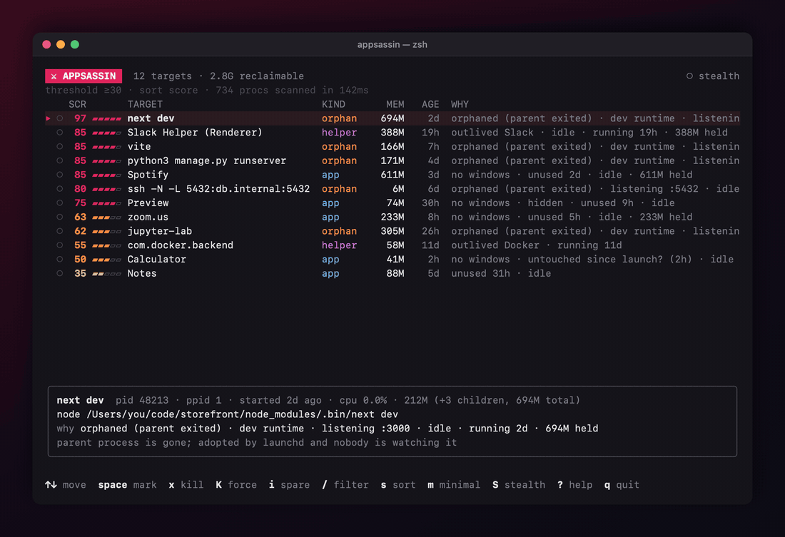
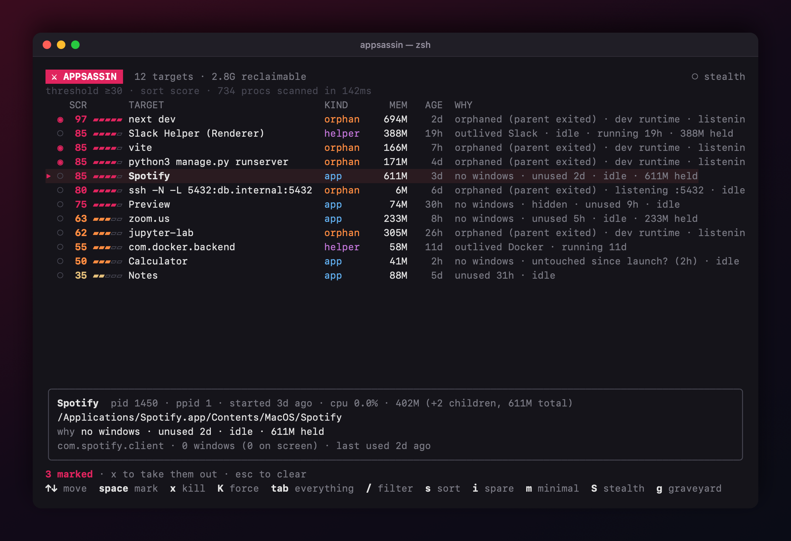
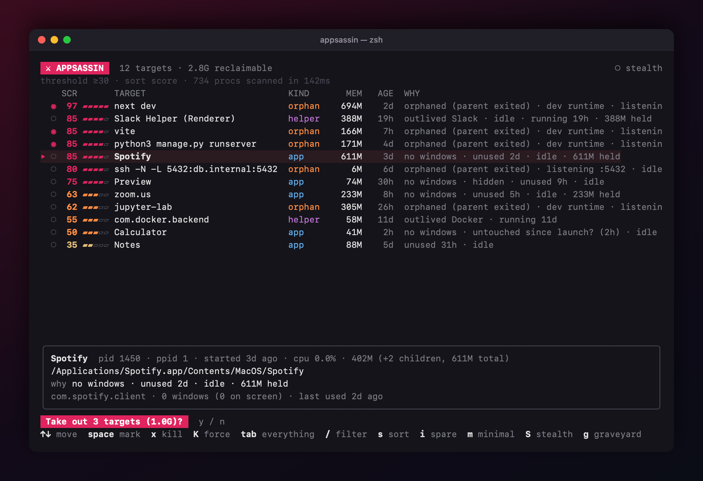
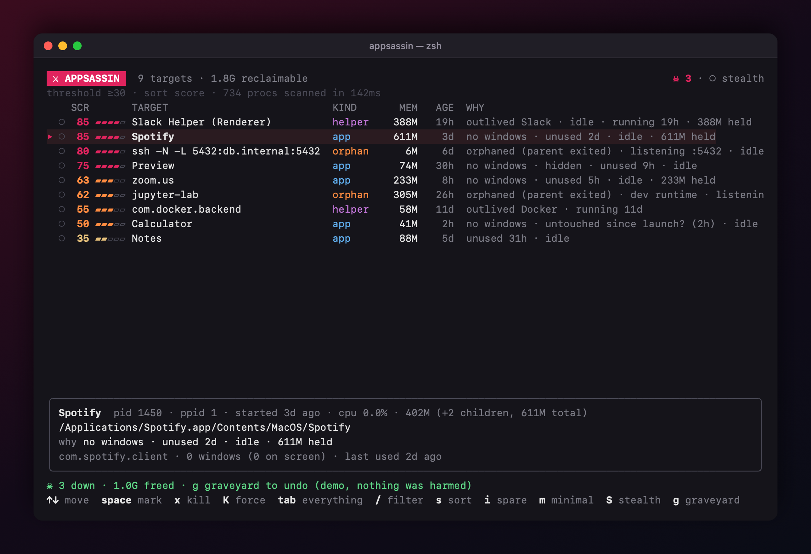
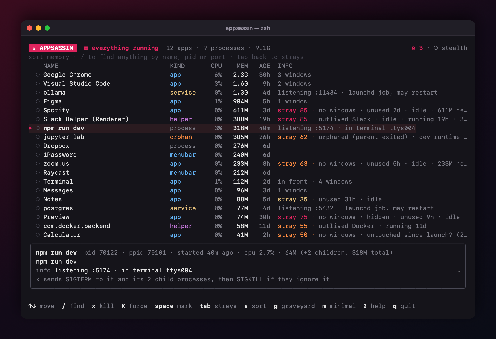
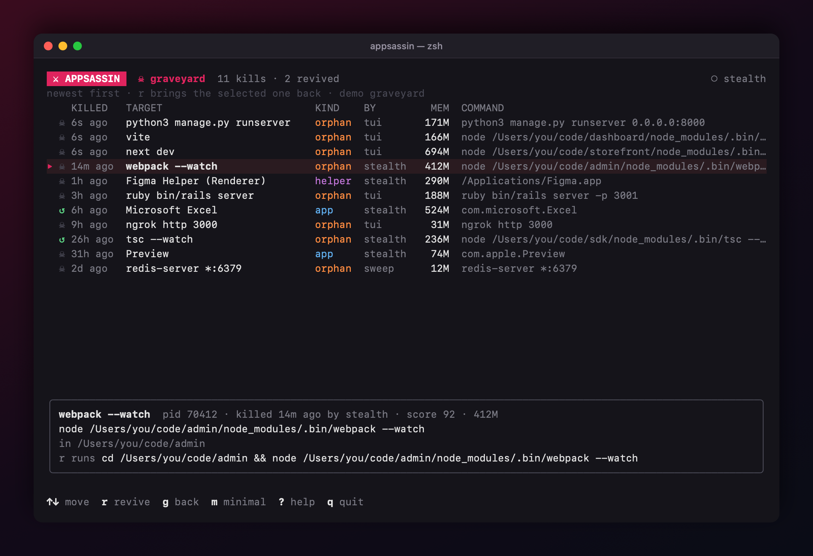
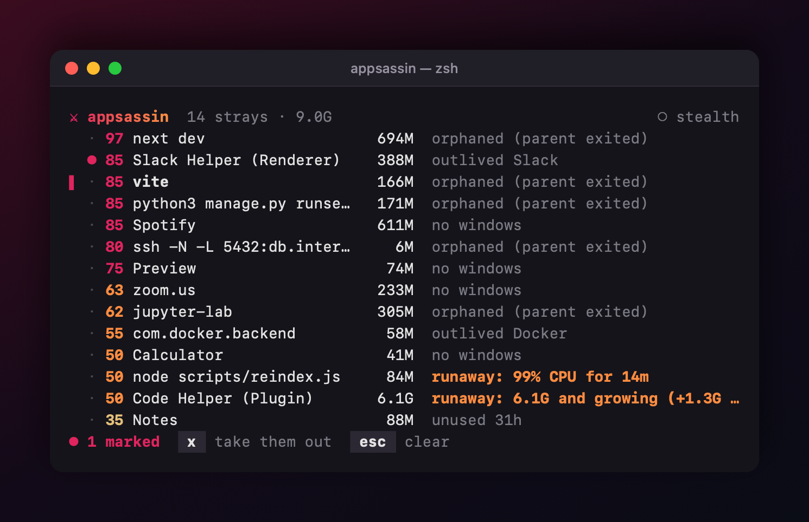
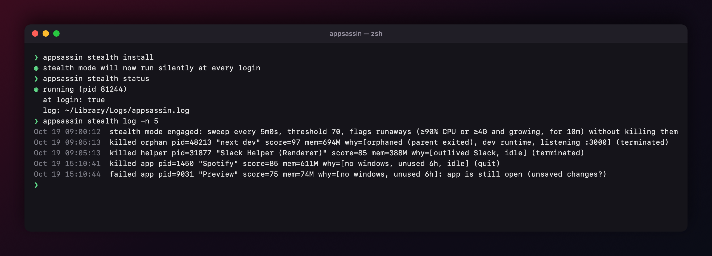

<div align="center">

# ⚔ appsassin

**Your Mac is full of things you forgot to close. appsassin finds them and takes them out.**

The `next dev` from a terminal tab you closed on Tuesday. The Slack helper that outlived Slack.
The SSH tunnel from last week. Spotify, open with no windows, holding 600 MB.
appsassin finds all of it, explains why each one looks forgotten, and kills what you pick.
You can also let it do this silently in the background. Every kill can be undone.
Want something else gone? `appsassin kill slack` or `appsassin kill :3000` works on anything you're running.

[](https://github.com/mikemich/appsassin/actions/workflows/ci.yml)
[](https://github.com/mikemich/appsassin/releases/latest)

[](LICENSE)



</div>

## Install

With Homebrew:

```bash
brew install mikemich/tap/appsassin
```

Or download the binary directly:

```bash
curl -fsSL https://github.com/mikemich/appsassin/releases/latest/download/appsassin-macos.tar.gz | tar xz
mkdir -p ~/.local/bin && mv appsassin ~/.local/bin/   # anywhere on your PATH
```

This is one universal binary for Apple Silicon and Intel Macs.

If you have Go:

```bash
go install github.com/mikemich/appsassin@latest
```

Then run `appsassin`. To look around first without risk, run `appsassin --demo`. Demo mode shows made-up targets, and kills are simulated.

## Why

Activity Monitor lists **everything**: about 700 processes, mostly macOS internals. `kill` needs a PID you have to dig up first. Neither knows which processes you *forgot about*.

appsassin only looks for **strays**:

| | What it is | How appsassin spots it |
|---|---|---|
| 🧟 **Orphans** | Dev servers, watchers, tunnels and agents whose terminal or parent process died | launchd adopted them (parent PID 1), they aren't launchd jobs, and they have no terminal |
| 👻 **Leftover helpers** | Helper processes that kept running after you quit their app | They live inside an `.app` bundle whose main app isn't running |
| 💤 **Forgotten apps** | Dock apps with no windows that you haven't touched in hours | Window count from CoreGraphics, plus a record of when each app was last in front |

Each target gets a **stray score** from 0 to 99, and every point comes with a reason you can read.

## Full mode



The list is sorted by how forgotten each target looks. The detail pane shows the full command line, PID, children, ports and memory. Mark targets with `space` and kill them with `x`. You always confirm first:



Processes get `SIGTERM` first, then `SIGKILL` if they ignore it. Each target's whole process tree goes with it, so `npm` doesn't leave a `node` behind. **Apps get a polite Cmd-Q**, so if they have unsaved work they can ask you about it. `K` force-kills when you really mean it.



## Kill anything, not just strays

Sometimes you know exactly what you want gone. Press `tab` in the app to see **everything you're running**: apps, menu-bar apps, launchd services, and processes in other terminal tabs. Each row shows its CPU, memory, ports and windows. Helpers are folded into their app, so Chrome is one row, not 40. Strays still show their score.

Press `/` and type part of a name, a PID or a port such as `:5174`. Then `x` kills it, with the same confirmation, the same polite Cmd-Q for apps, and the same graveyard. Start in this view with `appsassin -e`.



Or skip the app and do it from the shell:

```bash
appsassin kill slack           # by name (asks first; lets you pick if several match)
appsassin kill :3000           # whatever is listening on a port
appsassin kill 48213 -y        # by PID, without asking (-f to force)
appsassin ps                   # everything you're running, biggest first (--json)
```

## Graveyard

Every kill goes to the graveyard, whether you made it in the app, with `appsassin sweep`, or stealth mode made it while you weren't looking. appsassin records the full command line, its working directory, ports, and the bundle ID for apps. Bringing something back takes one command:

```bash
appsassin graveyard            # recent kills, newest first (--json, -n N)
appsassin revive 2             # by number…
appsassin revive "next dev"    # …or by name
```

Apps are reopened through LaunchServices (`open -b <bundle ID>`). Processes are re-run with their exact arguments in the directory they were started from. They run detached, with output going to `~/Library/Logs/appsassin-revived/`. appsassin prints exactly what it ran.

In the app, press `g` to open the graveyard and `r` to revive the selected entry.



The graveyard keeps the last 500 kills in `~/Library/Application Support/appsassin/graveyard.jsonl`. Only you can read the file, because command lines sometimes carry tokens.

## Minimal mode

One line per target and nothing else, so it fits in a small tmux split. Start it with `appsassin -m` or press `m` to toggle.



## Stealth mode

A silent background killer. It has no UI and prints nothing, and it runs at low CPU and I/O priority. It sweeps every 5 minutes and logs every kill.

```bash
appsassin stealth start            # for this login session (add --dry-run to only log)
appsassin stealth install          # start automatically at every login (LaunchAgent)
appsassin stealth status | log | stop | uninstall
```

You can also press `S` in the app.



Stealth mode is deliberately conservative:

- **Nothing it kills is lost.** Every kill lands in the [graveyard](#graveyard), and `appsassin revive <name>` brings it back. A process you revive is never killed again by stealth mode.
- It only acts on targets scoring **≥ 70**.
- It kills orphans and leftover helpers outright.
- **Apps are only ever asked to quit**, never force-killed. An app with unsaved changes stays open, and stealth mode logs it.
- An app qualifies only if it has **no windows** and stealth mode **actually watched it go unused for 6 hours**. Having been open for a long time isn't enough.
- While it runs, it records which app is in front. That makes "unused" times in the app real numbers instead of estimates.

## How the score works

| Signal | Points |
|---|---|
| Leftover helper of a quit app | +55 |
| Orphaned process (parent exited) | +45 |
| …and it's a dev runtime (`node`, `python`, `vite`, `next`, `rails`, `jupyter`…) | +15 |
| App with no windows | +40 |
| App hidden | +10 |
| App unused for >1h / >6h / >24h (half if never seen in front since launch) | +8 / +15 / +25 |
| Listening on a TCP port | +10 |
| Idle: under 0.5% CPU over its whole lifetime | +10 |
| Running for >2h / >24h / >7d | +5 / +10 / +15 |
| Holding >150 MB / >500 MB / >2 GB (whole process tree) | +5 / +10 / +20 |
| App visible on screen | −15 |
| Busy right now (≥25% CPU) | −20 |

## What it will never touch

It never kills these, not even when you ask:

- Anything owned by root or another user, or anything under `/System/Library`, `/usr/libexec`, `/usr/sbin` or `/Library/Apple`
- App extensions (`.appex`) and XPC services
- appsassin itself, the shell and terminal app it's running in, and Finder, Dock and Control Center

The stray hunt and stealth mode never flag these either. You can still kill them yourself from the everything view or with `appsassin kill`:

- launchd-managed jobs
- Processes attached to a terminal
- The front app, menu-bar and background-only apps
- Anything on your ignore list. Press `i` to spare a target forever. `tmux`, `screen`, `ssh-agent` and `gpg-agent` are on it by default.

Just before it sends a signal, appsassin checks that the PID still belongs to the same executable. A PID reused by another process is never hit.

It needs **no Accessibility, Screen Recording, Automation or admin permissions**.

## Keys

| Key | Action | Key | Action |
|---|---|---|---|
| `↑↓` `j k` | move | `/` | find by name, PID or `:port` |
| `tab` | strays ⇄ everything running | `s` | sort: score → memory → age → name → CPU |
| `space` | mark | `+` `-` | raise / lower the score threshold |
| `a` | mark all / none | `A` | show everything with any score |
| `x` | kill marked (or current) | `m` | toggle minimal mode |
| `K` | force kill | `S` | toggle stealth mode |
| `i` | spare it forever (ignore list) | `r` | rescan · in the graveyard: revive |
| `g` | graveyard (recent kills) | `?` / `q` | help / quit |
| `esc` | clear marks and filter | | |

## Command line

```bash
appsassin kill <name|pid|:port> [-y] [-f]       # kill anything you're running
appsassin ps [--json]                            # everything you're running
appsassin list [--all] [--json]                  # print stray targets, scriptable
appsassin sweep [--dry-run] [--apps] [--threshold N]  # one unattended pass, like stealth mode
appsassin graveyard [-n N] [--json]              # what was killed, newest first
appsassin revive <n|name>                        # bring a kill back
appsassin config                                 # where the config lives and what's in it
```

## Config

`~/.config/appsassin/config.json` is created on first run. Stealth mode re-reads it before every sweep.

```json
{
  "threshold": 30,
  "minimal": false,
  "ignore": ["tmux", "screen", "zellij", "ssh-agent", "gpg-agent", "mosh-server"],
  "stealth": { "interval": "5m", "threshold": 70, "apps": true, "appIdle": "6h", "dryRun": false }
}
```

Ignore entries match the name, executable, bundle ID or path, and can use globs such as `com.jetbrains.*`.

## Build from source

You need macOS, Go 1.22+ and the Xcode command-line tools. cgo is used for AppKit and CoreGraphics.

```bash
git clone https://github.com/mikemich/appsassin && cd appsassin
go build -o appsassin .
./scripts/screenshots.sh   # regenerates docs/ from --demo (needs tmux + ffmpeg)
```

## License

MIT. The screenshots and GIF use `--demo` data; no real processes were harmed.
